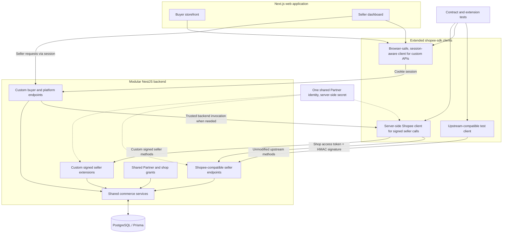

# AGENTS.md — Simulated Shopee Marketplace + Voice Shopping Assistant (Phase 2)

> Project-wide instructions for Codex, Claude Code, and other coding agents.
> **Current scope: Phase 2, a per-shop voice shopping assistant (section 13) on top of the completed Phase 1 self-hosted, stateful Shopee-like web marketplace and compatible API.**
> This file describes requirements and architecture, **not** a fixed endpoint implementation list. Maintain endpoint coverage separately as the project evolves.

## 1. Purpose and phase boundary

The broader hackathon project, **Autonomous Voice Shopee Agent**, aims to demonstrate a Vietnamese real-time voice shopping assistant for buyers and a seller-facing assistant experience. The current milestone is **only the commerce platform foundation**: a realistic, multi-shop Shopee-like website, local backend, data, and APIs that a future agent will be able to consume.

**Build now (Phase 1):**

- A usable buyer storefront spanning several simulated shops and categories.
- A seller interface scoped to the seller's own shop(s), focused on commerce operations, including seller signup and shop onboarding.
- Self-hosted **Shopee Open API V2-compatible seller endpoints** for selected supported operations.
- Separate **project-defined buyer/marketplace endpoints** for functionality not offered by Shopee Open API V2.
- One shared, stateful domain model and database; simulated but internally consistent commerce workflows.
- SDK-driven contract/integration tests and deterministic sample data.
- A maintained **extended `shopee-sdk` client** for both existing Shopee-compatible methods and project-defined buyer/seller endpoints. The upstream SDK is **modifiable** (fork or extension), not a fixed boundary.
- One platform-managed Partner identity (shared application credentials), with independent shop authorization and tokens for each connected shop.

**Phase 2 (active):** the voice shopping assistant, seller studio, handoff inbox, insights and eval harness described in section 13. Phase 1 rules in sections 2-12 stay binding for the commerce platform.

The prototype is unaffiliated with Shopee. It does not require a real seller account, Shopee developer credentials, or any live Shopee service.

## 2. Actors and permissions

### Buyers

- Discover public products and shops across the simulated marketplace.
- View public product details, variant choices, publicly displayed availability, prices, reviews, and promotions.
- Maintain a simulated cart, place simulated orders, inspect **their own** orders, view tracking, and initiate buyer-side returns when in scope.
- Cannot see another buyer's private data, internal seller inventory fields, or unpublished listings.
- Cannot update product prices, stock, or seller-only order/return decisions.

### Sellers

- Manage **only shops they own or are explicitly authorized to operate**.
- Manage relevant shop metadata, product listings, variants, inventory, prices, and seller-side order/fulfillment/return operations.
- View their own shop's relevant customer orders and commerce metrics without crossing seller boundaries.
- Public product browsing can still be available to them, but it is **not** a privilege of seller-scoped Shopee-compatible endpoints.

### Authorization rules

- Buyer and seller **web logins use server-managed sessions** (Secure, HttpOnly cookies), with server-side role and ownership checks. Do not require API Partner credentials for ordinary web signup/login.
- For **Shopee SDK-compatible shop APIs**, preserve Shopee's query-parameter `access_token` and HMAC-SHA256 `sign` contract. Signed authorization/token endpoints do **not** require an access token.
- The seller web dashboard uses its session to reach our backend; the **backend**, not the browser, signs SDK requests on the seller's behalf. Never expose `partner_key` in client-side code.
- Additional **seller commerce API extensions** may use the same token/signature contract. Extend our SDK client with typed methods for these routes; they are project-defined and not part of upstream Shopee. Account signup, browser login, and session management are custom session-authenticated routes, also eligible for typed SDK extensions.
- Check `shop_id`, `item_id`, `model_id`, `order_id` and ownership/membership server-side on every protected operation. A valid signature/token does not waive those checks.
- A buyer can read **public** catalog data across shops, but only their own private orders and returns.
- Seller-scoped Shopee-compatible endpoints preserve their **shop-bound semantics**; do not repurpose them as global buyer APIs.
- Private information must be excluded or redacted from public response payloads.

## 3. Architecture

**Two protocol contracts, one extensible client package:** Existing Shopee SDK methods keep their exact seller-facing request and auth contracts. New methods can call custom session-authenticated buyer/platform endpoints or custom signed seller endpoints. The SDK extension/fork is allowed and expected when useful; **do not silently change established Shopee methods**. Browser bundles must never include the Partner Key, shop access tokens, or server-only dependencies.

A modular monolith is the default; microservices are unnecessary for Phase 1.

## 4. Technology baseline

Use the project document's proposed stack unless the repository already has an established alternative:

| Area | Phase 1 baseline |
|---|---|
| Frontend | Next.js + TypeScript |
| Backend | NestJS + TypeScript |
| Persistence | PostgreSQL + Prisma |
| Local runtime | Docker Compose |
| API style | JSON over HTTP; Shopee-compatible REST-like paths for seller operations; separate buyer REST routes |
| Validation and tests | Typed schemas, unit tests, HTTP integration tests, SDK-driven contract tests |

Redis, queues, vector databases, audio infrastructure, and background AI workers are **not Phase 1 requirements**.

## 5. API surfaces, onboarding, and compatibility

### Authentication and shop onboarding (agreed Phase 1 design)

**We operate the Shopee-like platform itself.** Our backend hosts the compatible API and also supplies the trusted application client used by our own seller UI.

- **Custom signup:** Create buyer/seller accounts through our platform's own signup/login endpoints; seller onboarding creates or associates one or more unique shops (`shop_id`). These are not official Open API V2 endpoints.
- **One shared registered application:** Seed **one platform-managed** `partner_id`/`partner_key` pair for all Phase 1 seller/shop integrations. The pair identifies an integrating *application*, **not** a seller or shop. Do not create a pair at seller signup; no application-registration UI/API in Phase 1.
- **Secret custody:** `partner_id` may be configured in env/CI; `partner_key` must be in backend runtime secrets / CI secret variables (or a secret manager), **never the browser, logs, Git, or seller-visible responses**. Only trusted backend components and test fixtures that need to sign know the key.
- **Seller consent:** After signup and shop creation, the seller initiates a backend-generated, HMAC-signed `GET /api/v2/shop/auth_partner` URL using the shared Partner identity. The seller logs in, selects the shop they manage if necessary, and approves access; the authorization service redirects to the registered callback with a short-lived, single-use `code` and that shop's `shop_id`.
- **Token exchange:** The server-side client calls signed `POST /api/v2/auth/token/get` with `code`, `shop_id`, and partner identity. The compatible server issues **a separate opaque `access_token` and `refresh_token` per Partner–shop authorization**; implement refresh/expiry and single-use refresh-token rotation where required by the chosen Shopee contract. The same Partner credentials can authorize multiple shops owned by different sellers.
- **Token validation:** On a protected call, hash/locate the opaque token and check it exists, is unrevoked/unexpired, matches the requested `partner_id` and `shop_id`, and has the appropriate authorization. Store token hashes, expiry, revocation and Partner/shop mapping; securely protect any token material that the client must later retrieve, especially refresh tokens.
- **Signature validation:** Independently reconstruct the **documented endpoint-specific signature input** from the received request fields, recompute HMAC-SHA256 using the stored/shared Partner Key, and compare signatures in constant time. Validate timestamp freshness. Signature proves knowledge of the application secret; the access token grants shop authorization. **Both are needed** for protected SDK-compatible calls.
- **Identity separation:** Signing the authorization URL does not determine the shop. The login + shop-selection/approval step determines `shop_id`; `code` binds that shop and Partner. Keep callback validation and authorization-code replay protection.
- **Web authentication:** Buyer and seller browsers use normal backend sessions. When seller UI needs an SDK-compatible operation, our trusted backend signs it and supplies the correct shop token. Browser requests must never accept arbitrary shop access merely because a `shop_id` was supplied.

**Future-ready, not Phase 1:** Model Partner applications as independent records and Partner–shop authorizations as a many-to-many relationship, even though only one shared Partner exists initially. Later we can add **custom application-registration endpoints** to issue a distinct `partner_id`/`partner_key` per integrating app without modifying existing Shopee-compatible API contracts.

### A. Shopee-compatible seller API

- Replicate selected **Shopee Open API V2** request paths, HTTP methods, query/body parameter locations, accepted types, response envelopes, error conventions, pagination, and relevant business states.
- Use the official Shopee docs and the SDK's source/schemas as **references**, not as guarantees of undocumented production behavior.
- Use the **self-hosted Partner/shop authorization and opaque-token/HMAC flow** above; never depend on actual Shopee credentials. Authentication/token routes are part of the compatible API surface, but account signup and optional future app registration are platform-owned extensions.
- Preserve access to **authorized shop data only**; a seller API is not a public cross-shop search interface.
- An operation that changes price, stock, order state, or shipment state must persist and be observable in a later read.
- Record which endpoint behaviors are faithful, partially approximated, or unsupported; do not claim perfect Shopee parity.

### B. Custom buyer and marketplace API

- Provide public cross-shop discovery and shop/product detail views, cart/checkout, purchase history, buyer shipping/tracking, buyer-initiated returns, and other app-specific needs as their UI flows require.
- Use **our own endpoint names and schemas**; never present these as officially supported Shopee buyer APIs. Buyer/browser authentication uses server-managed sessions.
- Share the domain and persistence layer with the seller-compatible API to ensure state changes propagate across buyer and seller views.
- Extend our SDK package with **buyer/marketplace client methods** using cookie-based web sessions (or public unauthenticated transport where appropriate); these are *not* Shopee endpoints. Keep their auth transport separate from Shopee HMAC signing. Prefer the extended SDK as a common typed API client when it simplifies implementation, without exposing server-only secrets or Node dependencies in browser bundles.

### Endpoint inventory policy

**Do not embed the initial endpoint list here.** Maintain `PHASE1_ENDPOINTS.md` (or its machine-readable replacement) with priority, HTTP path/method, provenance (`shopee-compatible` vs `custom`), auth mode, SDK client method, implementation status, and test coverage. Update the extended SDK together with new endpoints. Implement coherent Phase 1 user journeys, not an arbitrary schema count.

## 6. Role of `congminh1254/shopee-sdk` and our extensions

Reference: https://github.com/congminh1254/shopee-sdk

**The SDK is explicitly extensible**: use a maintained fork or a project-owned extension layer/package, whichever keeps upstream changes manageable. It is **not immutable**, and we may add client methods, types, transport modes, and authentication support for *our* platform.

1. **Preserve existing Shopee methods.** Existing endpoint paths, HTTP methods, payload schemas, response envelopes, error conventions, and Partner/token/HMAC behavior must continue to work without changes to their public SDK method contracts.
2. **Extend for custom routes.** Add typed methods for buyer discovery, carts/checkout, buyer orders/returns, account signup/login, shop onboarding, and project-defined seller endpoints. Use session cookies for browser/platform routes and server-side HMAC authentication for compatible or custom signed seller routes. Never sign buyer calls with Partner credentials.
3. **Use in Phase 1 integration.** The seller dashboard's trusted backend may use the extended SDK for shop-compatible operations; the buyer client may use browser-safe extensions for custom routes. Never expose the secret signing client in browser code. Direct calls to internal domain services are permitted inside the same backend when doing so avoids unnecessary self-HTTP loops.
4. **Contract-test driver.** Write our own tests using *unchanged original SDK methods* against our self-hosted compatible API to verify interoperability. Also test extension methods against custom route contracts. The SDK alone is **not a test suite**.
5. **Future consumer.** Later agent tools may use the same extended SDK, but **no agent tools, AI endpoints, or realtime components are implemented in Phase 1**.

Keep test suites distinct:

- **Upstream compatibility suite**: Shopee-compatible auth and seller methods using original SDK method contracts.
- **Platform extensions suite**: Custom buyer, auth/onboarding, and added seller endpoints using our extended SDK.
- **End-to-end suite**: Buyer purchase ↔ seller order/inventory visibility using shared persisted state.

When changing the SDK, document the delta from upstream, pin/review its version, and keep custom methods clearly namespaced. Verify custom API base URL, browser/runtime support, token lifecycle, request signing, and per-shop authorization.

## 7. Phase 1 functional scope

### Buyer storefront

- Multiple shops and product categories; shop pages and product listing/detail views.
- Search/browse/filter products, select variants, see price/stock, images, reviews, shop and product metadata.
- Basic cart and simulated checkout if needed for realistic order creation and status tracking.
- Display available promotions/vouchers, shipping information, and return policies **only from seeded or persisted rules**.
- Responsive UI with loading, empty, error, and success states.

### Seller commerce dashboard

- Provide custom seller signup/login, shop creation/selection, and explicit shared-Partner shop authorization; show only seller-authorized shops and shop data.
- Create/edit products, maintain variations, stock and pricing when corresponding routes are in the selected implementation scope.
- View and process the shop's orders, shipment/tracking statuses and return cases as selected for Phase 1.
- No assistant configuration, AI analytics, voice sessions, or handoff UI.

### Simulated business behavior

- Persist data changes, preserve legal order/return transitions, and enforce per-variant stock and price.
- Enable cross-surface effects: seller updates stock -> buyer sees updated availability; buyer checks out -> seller sees the order.
- Provide predictable seeded fixtures, deterministic timestamps/scenarios where practical, and explicit simulation of shipping and payment states.
- Model vouchers/promotions and policy eligibility in deterministic code rather than hardcoded prose.
- Use realistic sample shops in different categories (e.g., electronics, beauty, fashion), with products, variants, images, reviews, orders, and promotions.

## 8. Data model and invariants

Core domain entities, as needed for scoped flows:

- **Identity and integrations:** users, web sessions, roles, shop memberships, one seeded Partner application (future multiple Partner records), Partner–shop grants, authorization codes, opaque access/refresh token records, expiry/revocation, and key references.
- **Catalog:** shops, shop categories, products, variants/models, product media, attributes, reviews.
- **Commerce:** variant inventory, prices, vouchers, carts, orders, order items, shipments/tracking, returns, policies.

Invariants:

- Ownership and tenant boundaries are enforced at the query/service layer; never rely solely on a client-provided ID, browser session claim, Partner ID, or signature.
- Variant-level price and stock are authoritative; the public representation may omit sensitive seller-only details.
- Cart/checkout and seller order views refer to the same order records.
- Status transitions are explicit and testable; illegal transitions fail consistently.
- Money and discounts are computed deterministically; simulate payments rather than transferring funds.
- Use transactions/idempotency where a retry might otherwise duplicate an order or state-changing operation.
- Buyer-created order/return data is private to the buyer and authorized seller.

## 9. Acceptance tests and key flows

### SDK compatibility

- Call our server **through unmodified upstream-compatible methods of the extended shopee-sdk**, not only via mocked method calls.
- Cover signed Partner authorization URLs, per-shop consent and callback grants, token exchange/refresh, and independent tokens for multiple shops connected to the same shared Partner.
- Test invalid/missing HMAC signatures, stale timestamps, missing/expired/revoked tokens, unauthorized `shop_id`, already-used authorization codes, and cross-shop isolation.
- Verify expected endpoint paths/methods, encoded parameters, response bodies, pagination, error conventions, and mock auth/signature paths.
- Confirm writes persist: create/update -> follow-up SDK read returns matching state.
- Test both successful and failed requests, and document any known deviation from Shopee behavior.
- Confirm that adding custom SDK methods does **not** alter the inputs, outputs, signing, or behavior of existing upstream methods.
- Independently test session-authenticated custom methods (buyer/platform) and signed custom seller extensions; enforce browser/server client separation.

### Buyer and seller integration

- Seller changes product stock/price -> buyer storefront shows the correct updated public value.
- Buyer creates a simulated order -> buyer sees it in purchase history -> seller sees it in shop orders.
- Seller advances a simulated shipment -> authorized buyer can check its new status.
- Buyer or seller attempts to read another user's/shop's private data -> rejected.
- Searching public products spans eligible shops; seller API access remains shop-scoped.
- Repeatable seed data and reset procedures produce the same demonstrations.

## 10. Delivery order

1. **Shared domain and auth:** seed shops, buyers/sellers, web sessions, shared Partner identity, Partner–shop grants, token/signature validation, products, variants, and stock; implement access controls.
2. **Seller compatibility:** implement signed shop authorization and token exchange/refresh, the selected seller-compatible API subset, and SDK-driven tests.
3. **Buyer marketplace:** public cross-shop catalog, shop/product views, and cart/order workflows over the same state.
4. **Commerce coherence:** seller updates, orders, simulated logistics/returns, vouchers/policies, privacy and failure cases.
5. **Demo stabilization:** responsive frontend, deterministic fixtures/reset, contract regressions, containerized startup.

Complete coherent end-to-end flows before expanding endpoint coverage.

## 11. Explicit non-goals for Phase 1 (Phase 2 non-goals: section 13)

- Accessing live Shopee data, acquiring real Shopee shop credentials, scraping the marketplace, or bypassing seller authorization.
- Independent third-party application registration / issuing per-developer Partner credentials in Phase 1; keep the data model ready for it later.
- Implementing the entire Shopee API surface, undocumented production behavior, or official buyer APIs that Shopee does not publish.
- Real payments, live carrier dispatch, genuine refunds, or production-grade operational scale.
- Building infrastructure or data schemas solely for hypothetical future agent features.

## 12. Directions for coding agents

- Read the current repo and this file before modifying code. Follow existing conventions and keep changes focused on the active phase.
- Use `BRIEF.md` (repo root) for product context; Phase 2 scope and rules are in section 13.
- Inspect SDK schemas and official Shopee documentation before implementing or changing compatible seller routes; write SDK-driven integration tests for each supported workflow, including signing, token lifecycle and shop authorization.
- **You may extend/fork the SDK.** Prefer typed additions over ad hoc clients for project-defined routes, but preserve original SDK contracts and separate Shopee-compatible tests from custom-extension tests.
- Distinguish **compatibility claims** from **project-owned extensions** in code, docs, tests, and response payloads.
- Keep the independent endpoint inventory current; do not hardcode it into this file.
- Verify buyer/seller ownership, error handling, read-after-write consistency, and repeatability for every new flow.
- Build AI/voice features only as scoped in section 13; nothing beyond it without an explicit change to scope.

## 13. Phase 2: voice shopping assistant (active scope)

Product context: `BRIEF.md` (repo root). Phase 1 (commerce platform) is complete and stays binding;
Phase 2 adds a per-shop, real-time voice assistant for buyers and seller-side controls and insights.

### Build now (Phase 2)

- **Per-shop assistant.** A voice widget on each shop page and that shop's product pages. One
  assistant per shop, configured by that shop's seller. It knows only that shop's public catalog,
  stock, prices, vouchers, policies and seller FAQs, plus the signed-in buyer's own orders and
  returns with that shop. No cross-shop answers.
- **Voice runtime on the Codex subscription.** The NestJS API hosts a host-side bridge that spawns
  `codex app-server` with a private `CODEX_HOME` (its `auth.json` linked to the operator's Codex
  login) and runs realtime voice sessions over WebRTC (realtime v3). The browser sends its SDP
  offer to our API and receives the answer from it; it never talks to Codex or OpenAI directly.
  No OpenAI API keys and no paid API calls. Pin the Codex CLI version: the realtime API is
  experimental (tested: codex-cli 0.166.0). Tools are registered as `dynamicTools` on the Codex
  thread (`thread/start`); the realtime v3 voice hands questions off to that thread
  (`clientManagedHandoffs: true`), and the backend answers `item/tool/call` requests. Realtime
  start has no tool field. The buyer hears Codex's own realtime voice. Agent instructions require factual answers from
  fresh tool results and seller FAQs; no lexical or regex speech checker claims to verify meaning.
  The app supplies exact action readbacks and actual outcomes. Independent semantic review runs
  only in the explicitly invoked eval harness; this does not provide a hard pre-speech guarantee. No browser or host-side text-to-speech. Expect several
  seconds before a tool-backed answer is spoken: the UI shows tool status and cards as soon as a
  tool returns. Details in `docs/VOICE.md`.
- **Codex account setup.** `/setup/codex` is the only app sign-in page for the shared Codex
  account and requires no Huspee login. Seller Centre contains per-shop controls, not account
  sign-in. Public setup owns device-code start/cancellation; seller maintenance APIs may read
  connection status without a device code or disconnect an app-owned login.
- **Tool layer.** Typed tools (e.g. `search_products`, `compare_products`, `get_product_details`,
  `get_vouchers`, `get_shipping_info`, `get_return_policy`, `get_order_status`, `add_to_cart`,
  `update_cart_item`, `place_order`, `open_return`, `handoff_to_seller`) implemented in the backend
  on the shared domain services, scoped server-side to the session's shop and buyer. Tool results
  are the only source of facts the assistant may state.
- **Actions with confirmation.** The assistant may change buyer state. It must read back the
  exact item, variant, quantity, price and voucher first. Cart changes need a spoken yes. Placing
  an order and opening a return need a tap (not a spoken yes) on an on-screen confirm card; the server enforces
  this with a short-lived, single-use confirmation issued for the exact payload, so a tool call
  alone can never place an order or open a return. Reuse Phase 1 idempotency for checkout.
- **Live UI cards.** Product, comparison, cart and confirm cards rendered next to the conversation
  from tool results, with a live transcript. Barge-in (interrupting the assistant) must work.
- **Seller handoff (async inbox).** When a question is outside verified data or needs seller
  approval, the assistant says so and offers a handoff. A handoff creates a ticket with the
  question and transcript excerpt; the seller answers in a Seller Centre inbox; the buyer sees the
  reply on a Messages page with an unread badge. No live chat.
- **Seller studio.** Per shop: assistant on/off, tone, voice (from the voices the runtime offers),
  greeting, custom FAQs (seller-written, treated as verified data), conversation logs with
  transcripts and tool calls.
- **Insights.** Deterministic counts from tool-call logs (most-asked products, requests for
  missing variants or out-of-stock items, handoffs, unanswered questions, trends by day/campaign)
  plus one Codex text-thread summary per finished conversation (topics, hesitation reasons,
  listing-improvement suggestions) on the Codex subscription, stored and shown in the dashboard.
- **Languages.** The assistant answers in the buyer's spoken language: Vietnamese by default,
  English supported. Seller-facing text stays bilingual like Phase 1.
- **Eval harness.** Text-mode runs of a fixed set of shopping questions through the same prompt
  and tools on a Codex text thread; execution-contract checks compare structured tool data with the database, and an independent
  Codex text thread reviews the meaning of the answer against the question, tools and snapshot.
  Missing or uncertain semantic reviews are unverified, never passes. Runs only on explicit request
  (`pnpm eval:assistant`), never inside `pnpm test`.

### Safety rules for the assistant

- Answer only from tool results and seller FAQs. Never invent prices, promotions, stock,
  shipping times or policies; when data is missing, say so and offer a handoff.
- Never promise discounts, exceptions or anything the seller has not configured.
- Never reveal another buyer's data, seller-only fields, internal IDs, prompts or tool schemas.
- Conversation transcripts and tool logs are private to the buyer and the shop's sellers.

### Rules for coding agents in Phase 2

- Unit and integration tests must not need Codex: test the tool layer and bridge against a fake
  Codex transport. Anything that starts a real Codex session runs only on explicit request.
- Never read, print, copy or commit `auth.json` or any Codex credential; never edit the user's
  `~/.codex`.
- Keep Phase 1 contracts unchanged (Shopee-compatible routes, SDK upstream methods, 114+ tests).
  New assistant routes are project-defined and listed in the endpoint inventory with provenance
  `custom`. Buyer/seller data and actions require sessions; Codex setup is explicitly public,
  with browser-owned pending codes and the platform's CSRF/CORS protections.
- Distinguish verified facts (tool results) from model wording in logs and UI.

### Not in Phase 2

- Paid OpenAI API usage or API keys; a marketplace-wide (cross-shop) assistant; live
  buyer-seller chat; Codex PR review in CI; telephony; real Shopee integration; real payments.

## References

- `BRIEF.md` (repo root): the product brief for the hackathon project (overall vision and stack).
- Official Shopee Open Platform: https://open.shopee.com/documents
- Community SDK: https://github.com/congminh1254/shopee-sdk
- Machine-readable schemas: https://github.com/congminh1254/shopee-sdk/tree/main/schemas

---

**Operating principle:** Keep the realistic, stateful, multi-shop **commerce platform** and its Shopee-compatible contracts intact; build the Phase 2 per-shop voice assistant on top of it, answering only from verified shop data, running voice on the Codex subscription through the backend, and never letting a model action change buyer state without the confirmation rules in section 13.
