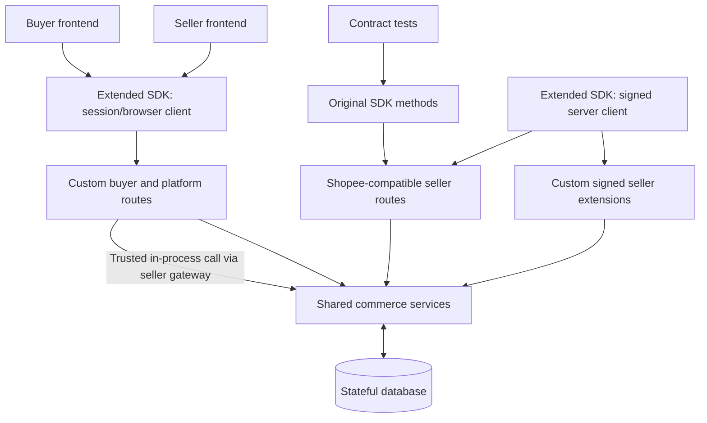

# Phase 1 API Endpoint Inventory

> Self-hosted simulated Shopee marketplace. **No voice/AI endpoints in Phase 1.**
> Maintained separately from `AGENTS.md` so scope and contract coverage can change independently.
> Behavioural fidelity notes for every Shopee-compatible area live in [`docs/COMPATIBILITY.md`](docs/COMPATIBILITY.md).
> A machine-readable list of served `/api/v2` operations is available at `GET /api/v1/meta/compat-operations`.

## Legend and contract boundaries

- **P0**: required to demonstrate the first coherent buyer ↔ seller commerce workflows; **P1**: subsequent Phase 1 coverage; **+**: served in addition to the original inventory.
- **Shopee-compatible**: preserve original Shopee Open API V2 endpoint paths, methods, request/response envelopes, auth and shop-scoping. Listed `module.operation` identifiers correspond to SDK/schema operation names.
- **Custom session API**: project-defined HTTP routes under `/api/v1`, with public or cookie-session authentication and resource ownership checks.
- **Custom signed seller extension**: project-defined operation, **not** an official Shopee endpoint; requires shop-scoped access token + HMAC and is implemented in our extended SDK.
- **Extended SDK**: upstream-compatible seller methods must remain functional. Add typed methods for *both* new buyer/session routes and custom signed seller routes. Browser/client-facing extensions cannot embed `partner_key` or shop access tokens.

**Auth modes**

| Code | Meaning |
|---|---|
| `partner` | Shopee partner-level signature: `sign = HMAC-SHA256(partner_key, partner_id + path + timestamp)`; no access token |
| `shop` | Shopee shop-level signature: `partner_id + path + timestamp + access_token + shop_id`, plus opaque token → partner/shop/active-grant validation |
| `public` | No authentication (public catalog data only) |
| `session` | `huspee_sid` HttpOnly cookie; state-changing requests also need `X-Requested-With` |
| `session:buyer` / `session:seller` | Session with the given role; resources are additionally ownership/membership checked |

**SDK columns.** Upstream methods are those of `@congminh1254/shopee-sdk@2.12.0` (`sdk.<manager>.<method>`), inherited unchanged by `HuspeeShopeeSDK` in `@huspee/sdk/server`. Huspee methods live on `HuspeeClient` (`@huspee/sdk`, browser-safe) or `HuspeeShopeeSDK.custom` (server-only).

**Test columns.** `U` = `tests/upstream` (unmodified upstream SDK methods), `X` = `tests/extensions` (Huspee SDK extensions), `E` = `tests/e2e` (cross-surface flows). `/api/v1` and other non-Shopee rows marked `U` are exercised by the upstream suite as fixtures for SDK flows, not through upstream SDK methods.

**Status.** ✅ implemented and tested · ⚠️ implemented, approximation documented in `docs/COMPATIBILITY.md` · ❌ not implemented.

## A. Shopee Open API V2-compatible seller endpoints

All paths are under `/api/v2`. Every shop-level call is also reachable from the seller dashboard through the trusted gateway `POST /api/v1/seller/shops/:shopId/shopee` (see section C).

### A1. Authentication, shop and shop categories

| Pri | Operation | Method & path | Auth | SDK method | Status | Tests |
|---|---|---|---|---|---|---|
| P0 | `shop.auth_partner` | GET `/shop/auth_partner` (+ consent pages `…/consent`, `…/login`, `…/approve`) | partner (URL) + seller login | `HuspeeShopeeSDK.buildAuthPartnerUrl()`; upstream `getAuthorizationUrl()` targets Shopee's newer unsigned page and is **not** supported | ✅ | U, X |
| P0 | `auth.token.get` | POST `/auth/token/get` | partner | `sdk.authenticateWithCode`, `sdk.auth.getAccessToken`, `sdk.public.getAccessToken` | ✅ | U, X |
| P0 | `auth.access_token.get` | POST `/auth/access_token/get` | partner | `sdk.refreshToken`, `sdk.auth.getRefreshToken`, `sdk.public.refreshAccessToken` | ✅ | U |
| P0 | `public.get_shops_by_partner` | GET `/public/get_shops_by_partner` | partner | `sdk.public.getShopsByPartner` | ✅ | U |
| P0 | `shop.get_shop_info` | GET `/shop/get_shop_info` | shop | `sdk.shop.getShopInfo` | ✅ | U |
| P0 | `shop.get_profile` | GET `/shop/get_profile` | shop | `sdk.shop.getProfile` | ✅ | U |
| P0 | `shop.update_profile` | POST `/shop/update_profile` | shop | `sdk.shop.updateProfile` | ✅ | U |
| P1 | `shop.get_shop_holiday_mode` | GET `/shop/get_shop_holiday_mode` | shop | `sdk.shop.getShopHolidayMode` | ✅ | U |
| + | `shop.set_shop_holiday_mode` | POST `/shop/set_shop_holiday_mode` | shop | `sdk.shop.setShopHolidayMode` | ✅ | U |
| P0 | `shop_category.get_shop_category_list` | GET `/shop_category/get_shop_category_list` | shop | `sdk.shopCategory.getShopCategoryList` | ✅ | U |
| P0 | `shop_category.get_item_list` | GET `/shop_category/get_item_list` | shop | `sdk.shopCategory.getItemList` | ✅ | U |
| P1 | `shop_category.add_shop_category` | POST `/shop_category/add_shop_category` | shop | `sdk.shopCategory.addShopCategory` | ✅ | U |
| P1 | `shop_category.update_shop_category` | POST `/shop_category/update_shop_category` | shop | `sdk.shopCategory.updateShopCategory` | ✅ | U |
| P1 | `shop_category.add_item_list` | POST `/shop_category/add_item_list` | shop | `sdk.shopCategory.addItemList` | ✅ | U |
| + | `shop_category.delete_item_list` | POST `/shop_category/delete_item_list` | shop | `sdk.shopCategory.deleteItemList` | ✅ | U |
| + | `shop_category.delete_shop_category` | POST `/shop_category/delete_shop_category` | shop | `sdk.shopCategory.deleteShopCategory` | ✅ | U |

### A2. Products, variants, media

| Pri | Operation | Method & path | Auth | SDK method | Status | Tests |
|---|---|---|---|---|---|---|
| P0 | `product.get_item_list` | GET `/product/get_item_list` | shop | `sdk.product.getItemList` | ✅ | U |
| P0 | `product.search_item` | GET `/product/search_item` | shop | `sdk.product.searchItem` | ✅ | U |
| P0 | `product.get_item_base_info` | GET `/product/get_item_base_info` | shop | `sdk.product.getItemBaseInfo` | ✅ | U, E |
| P0 | `product.get_model_list` | GET `/product/get_model_list` | shop | `sdk.product.getModelList` | ✅ | U |
| P0 | `product.get_item_extra_info` | GET `/product/get_item_extra_info` | shop | `sdk.product.getItemExtraInfo` | ✅ | U |
| P0 | `product.get_comment` | GET `/product/get_comment` | shop | `sdk.product.getComment` | ✅ | U, E |
| + | `product.reply_comment` | POST `/product/reply_comment` | shop | `sdk.product.replyComment` | ✅ | U |
| P0 | `product.get_item_promotion` | GET `/product/get_item_promotion` | shop | `sdk.product.getItemPromotion` | ⚠️ discount promotions only | U |
| P0 | `product.get_category` | GET `/product/get_category` | shop | `sdk.product.getCategory` | ✅ | U |
| P0 | `product.get_attribute_tree` | GET `/product/get_attribute_tree` | shop | `sdk.product.getAttributeTree` | ✅ | U |
| P0 | `product.add_item` | POST `/product/add_item` | shop | `sdk.product.addItem` | ✅ | U, E |
| P0 | `product.update_item` | POST `/product/update_item` | shop | `sdk.product.updateItem` | ✅ | U |
| P0 | `product.init_tier_variation` | POST `/product/init_tier_variation` | shop | `sdk.product.initTierVariation` | ⚠️ accepts `tier_variation` and `standardise_tier_variation` | U, E |
| + | `product.update_tier_variation` | POST `/product/update_tier_variation` | shop | `sdk.product.updateTierVariation` | ⚠️ rename/append options only | U |
| P0 | `product.add_model` | POST `/product/add_model` | shop | `sdk.product.addModel` | ✅ | U |
| P0 | `product.update_stock` | POST `/product/update_stock` | shop | `sdk.product.updateStock` | ✅ | U, E |
| P0 | `product.update_price` | POST `/product/update_price` | shop | `sdk.product.updatePrice` | ✅ | U, E |
| P0 | `media_space.upload_image` | POST `/media_space/upload_image` (multipart `image`) | shop | `sdk.mediaSpace.uploadImage` | ⚠️ shop-level auth | U, X, E |
| + | `media.upload_image` | POST `/media/upload_image` (multipart `images`) | shop | `sdk.media.uploadImage` | ⚠️ shop-level auth | U |
| P1 | `product.update_model` | POST `/product/update_model` | shop | `sdk.product.updateModel` | ✅ | U |
| + | `product.delete_model` | POST `/product/delete_model` | shop | `sdk.product.deleteModel` | ✅ | U |
| P1 | `product.unlist_item` | POST `/product/unlist_item` | shop | `sdk.product.unlistItem` | ✅ | U, E |
| P1 | `product.delete_item` | POST `/product/delete_item` | shop | `sdk.product.deleteItem` | ✅ | U |
| P1 | `product.get_brand_list` | GET `/product/get_brand_list` | shop | `sdk.product.getBrandList` | ✅ | U |

### A3. Promotions and vouchers

| Pri | Operation | Method & path | Auth | SDK method | Status | Tests |
|---|---|---|---|---|---|---|
| P0 | `voucher.get_voucher_list` | GET `/voucher/get_voucher_list` | shop | `sdk.voucher.getVoucherList` | ✅ | U |
| P0 | `voucher.get_voucher` | GET `/voucher/get_voucher` | shop | `sdk.voucher.getVoucher` | ✅ | U |
| P0 | `voucher.add_voucher` | POST `/voucher/add_voucher` | shop | `sdk.voucher.addVoucher` | ⚠️ coin cashback unsupported | U |
| P1 | `voucher.update_voucher` | POST `/voucher/update_voucher` | shop | `sdk.voucher.updateVoucher` | ✅ | U |
| P1 | `voucher.end_voucher` | POST `/voucher/end_voucher` | shop | `sdk.voucher.endVoucher` | ✅ | U |
| + | `voucher.delete_voucher` | POST `/voucher/delete_voucher` | shop | `sdk.voucher.deleteVoucher` | ✅ | U |

### A4. Orders and logistics

| Pri | Operation | Method & path | Auth | SDK method | Status | Tests |
|---|---|---|---|---|---|---|
| P0 | `order.get_order_list` | GET `/order/get_order_list` | shop | `sdk.order.getOrderList` | ✅ | U |
| P0 | `order.get_order_detail` | GET `/order/get_order_detail` | shop | `sdk.order.getOrderDetail` | ⚠️ subset of optional fields | U, E |
| P0 | `order.cancel_order` | POST `/order/cancel_order` | shop | `sdk.order.cancelOrder` | ✅ | U |
| P0 | `logistics.get_channel_list` | GET `/logistics/get_channel_list` | shop | `sdk.logistics.getChannelList` | ✅ | U |
| P0 | `logistics.get_shipping_parameter` | GET `/logistics/get_shipping_parameter` | shop | `sdk.logistics.getShippingParameter` | ⚠️ simulated time slots, no branches | U, E |
| P0 | `logistics.get_address_list` | GET `/logistics/get_address_list` | shop | `sdk.logistics.getAddressList` | ✅ | U |
| P0 | `logistics.ship_order` | POST `/logistics/ship_order` | shop | `sdk.logistics.shipOrder` | ⚠️ pickup/dropoff; non_integrated ignored | U, E |
| P0 | `logistics.get_tracking_info` | GET `/logistics/get_tracking_info` | shop | `sdk.logistics.getTrackingInfo` | ✅ | U, E |
| P0 | `logistics.get_tracking_number` | GET `/logistics/get_tracking_number` | shop | `sdk.logistics.getTrackingNumber` | ✅ | U |

### A5. Returns and refunds

| Pri | Operation | Method & path | Auth | SDK method | Status | Tests |
|---|---|---|---|---|---|---|
| P0 | `returns.get_return_list` | GET `/returns/get_return_list` | shop | `sdk.returns.getReturnList` | ✅ | U, E |
| P0 | `returns.get_return_detail` | GET `/returns/get_return_detail` | shop | `sdk.returns.getReturnDetail` | ✅ | U |
| P0 | `returns.get_available_solutions` | GET `/returns/get_available_solutions` | shop | `sdk.returns.getAvailableSolutions` | ✅ | U |
| P0 | `returns.confirm` | POST `/returns/confirm` | shop | `sdk.returns.confirm` | ⚠️ refund simulated as paid immediately | U, E |
| P1 | `returns.get_reverse_tracking_info` | GET `/returns/get_reverse_tracking_info` | shop | `sdk.returns.getReverseTrackingInfo` | ⚠️ simulated reverse logistics | U |
| P1 | `returns.offer` | POST `/returns/offer` | shop | `sdk.returns.offer` | ✅ | U |
| P1 | `returns.dispute` | POST `/returns/dispute` | shop | `sdk.returns.dispute` | ⚠️ stays `JUDGING` (no platform arbitration) | U |
| + | `returns.get_return_dispute_reason` | GET `/returns/get_return_dispute_reason` | shop | `sdk.returns.getReturnDisputeReason` | ✅ | U |
| + | `returns.cancel_dispute` | POST `/returns/cancel_dispute` | shop | `sdk.returns.cancelDispute` | ✅ | U |
| — | `returns.accept_offer` (seller accepts buyer counter-offer) | — | — | `sdk.returns.acceptOffer` | ❌ buyers cannot counter-offer in Phase 1 | — |

### A6. Push configuration and simulated event delivery

| Pri | Endpoint/event | Method & path | Auth | SDK method | Status | Tests |
|---|---|---|---|---|---|---|
| P1 | `push.set_app_push_config` | POST `/push/set_app_push_config` | shop | `sdk.push.setAppPushConfig` | ⚠️ per-partner config | U, E |
| P1 | `push.get_app_push_config` | GET `/push/get_app_push_config` | shop | `sdk.push.getAppPushConfig` | ⚠️ per-partner config | U |
| + | `push.get_lost_push_message` / `push.confirm_consumed_lost_push_message` | GET/POST `/push/…` | shop | `sdk.push.getLostPushMessage`, `sdk.push.confirmConsumedLostPushMessage` | ✅ | U |
| P1 | Outbound order/tracking/inventory/promotion/return event delivery | POST to configured callback, `Authorization: HMAC(url + "|" + body)` | — | `verifyPushSignature()` (`@huspee/sdk/server`) | ⚠️ codes 1, 2, 3, 4, 8, 9, 29 | U, E |

## B. Custom buyer/customer endpoints (`/api/v1`, `HuspeeClient`)

These are **project-owned**, not actual Shopee Open API V2 buyer methods. Responses use `{ data }` (lists add `page`), errors use `{ error: { code, message, details? } }`.

### B1. Public marketplace

| Pri | Method | Route | Auth | SDK method | Status | Tests |
|---|---|---|---|---|---|---|
| P0 | GET | `/marketplace/shops` | public | `marketplace.listShops` | ✅ | X |
| P0 | GET | `/marketplace/shops/:shopId` | public | `marketplace.getShop` | ✅ | X |
| P0 | GET | `/marketplace/products` | public | `marketplace.searchProducts` | ✅ | X, E |
| P0 | GET | `/marketplace/products/:itemId` | public | `marketplace.getProduct` | ✅ | X, E |
| P0 | GET | `/marketplace/products/:itemId/reviews` | public | `marketplace.getReviews` | ✅ | X, E |
| P0 | GET | `/marketplace/categories` | public | `marketplace.categories` | ✅ | X |
| P0 | GET | `/marketplace/shops/:shopId/vouchers` | public | `marketplace.shopVouchers` | ✅ | X |
| P0 | GET | `/marketplace/shops/:shopId/policies` | public | `marketplace.shopPolicies` | ✅ | X |

### B2. Cart, checkout, delivery

| Pri | Method | Route | Auth | SDK method | Status | Tests |
|---|---|---|---|---|---|---|
| P0 | GET | `/cart` | session:buyer | `cart.get` | ✅ | X |
| P0 | POST | `/cart/items` | session:buyer | `cart.addItem` | ✅ | X, E |
| P0 | PATCH | `/cart/items/:cartItemId` | session:buyer | `cart.updateItem` | ✅ | X |
| P0 | DELETE | `/cart/items/:cartItemId` | session:buyer | `cart.removeItem` | ✅ | X |
| P0 | POST | `/checkout/preview` | session:buyer | `checkout.preview` | ✅ | X |
| P0 | POST | `/checkout` (`Idempotency-Key` header) | session:buyer | `checkout.placeOrder` | ✅ | X, E |
| P0 | GET | `/buyer/addresses` | session:buyer | `buyer.addresses.list` | ✅ | X |
| P0 | POST | `/buyer/addresses` | session:buyer | `buyer.addresses.create` | ✅ | X |
| P1 | PATCH | `/buyer/addresses/:addressId` | session:buyer | `buyer.addresses.update` | ✅ | X |
| P1 | DELETE | `/buyer/addresses/:addressId` | session:buyer | `buyer.addresses.remove` | ✅ | X |
| P0 | POST | `/shipping/quote` | session:buyer | `shipping.quote` | ✅ | X |

### B3. Buyer orders, returns and reviews

| Pri | Method | Route | Auth | SDK method | Status | Tests |
|---|---|---|---|---|---|---|
| P0 | GET | `/buyer/orders` | session:buyer | `buyer.orders.list` | ✅ multi-status | X, E |
| P0 | GET | `/buyer/orders/:orderId` | session:buyer | `buyer.orders.get` | ✅ | X, E |
| P0 | POST | `/buyer/orders/:orderId/cancel` | session:buyer | `buyer.orders.cancel` | ⚠️ immediate (no `IN_CANCEL`) | X, E |
| P0 | GET | `/buyer/orders/:orderId/tracking` | session:buyer | `buyer.orders.tracking` | ✅ | X, E |
| + | POST | `/buyer/orders/:orderId/confirm-receipt` | session:buyer | `buyer.orders.confirmReceipt` | ✅ | E |
| P0 | POST | `/buyer/returns` | session:buyer | `buyer.returns.create` | ✅ | U, E |
| P0 | GET | `/buyer/returns` | session:buyer | `buyer.returns.list` | ✅ | U |
| P0 | GET | `/buyer/returns/:returnId` | session:buyer | `buyer.returns.get` | ✅ | U, E |
| P1 | POST | `/buyer/returns/:returnId/accept-offer` | session:buyer | `buyer.returns.acceptOffer` | ✅ | U |
| + | POST | `/buyer/returns/:returnId/cancel` | session:buyer | `buyer.returns.cancel` | ✅ | U, E |
| P1 | POST | `/buyer/orders/:orderId/reviews` | session:buyer | `buyer.orders.review` | ✅ | U, E |

`:orderId` is the Shopee-style `order_sn`; `:returnId` is the `return_sn`.

## C. Custom platform identity and seller onboarding endpoints (`/api/v1`, `HuspeeClient`)

| Pri | Method | Route | Auth | SDK method | Status | Tests |
|---|---|---|---|---|---|---|
| P0 | POST | `/auth/signup` | public | `auth.signup` | ✅ | X |
| P0 | POST | `/auth/login` | public | `auth.login` | ✅ | X |
| P0 | POST | `/auth/logout` | session | `auth.logout` | ✅ | X |
| P0 | GET | `/auth/me` | session | `auth.me` | ✅ | X |
| P0 | POST | `/seller/shops` | session:seller | `seller.shops.create` | ✅ | X, E |
| P0 | GET | `/seller/shops` | session:seller | `seller.shops.list` | ✅ | X |
| P0 | GET | `/seller/shops/:shopId` | session:seller | `seller.shops.get` | ✅ | X |
| P0 | GET | `/seller/shops/:shopId/authorization-url` | session:seller (owner) | `seller.shops.authorizationUrl` | ✅ | X, E |
| P0 | GET | `/integrations/shopee/callback` | session:seller + state cookie | `integrations.completeShopeeCallback` (non-browser) | ✅ | X, E |
| P0 | GET | `/seller/shops/:shopId/connection-status` | session:seller | `seller.shops.connectionStatus` | ✅ | X |
| P1 | POST | `/seller/shops/:shopId/disconnect` | session:seller (owner) | `seller.shops.disconnect` | ✅ | U, X |
| P1 | GET | `/seller/dashboard/summary?shop_id=` | session:seller | `seller.dashboardSummary` | ✅ | X, E |
| + | POST | `/seller/shops/:shopId/shopee` (`{ path, params }` or multipart) | session:seller + connected shop | `seller.shopee.call`, `seller.shopee.uploadImage` | ✅ | X, E |
| + | GET | `/seller/shops/:shopId/shopee/operations` | session:seller | `seller.shopee.operations` | ✅ | X |
| + | GET | `/meta/compat-operations` | public | — | ✅ | U |
| + | GET | `/media/:imageId` (no `/api/v1` prefix) | public | — | ✅ | U |
| + | GET | `/healthz` (no `/api/v1` prefix) | public | — | ✅ | setup |

## D. Project-owned signed seller extensions (`/api/v2/custom/*`, `HuspeeShopeeSDK.custom`)

These operations are **not official Shopee APIs**, but intentionally reuse our shop-scoped `access_token` + HMAC verification. Responses carry `X-Huspee-Provenance: custom-signed`.

| Pri | Method | Route | Auth | SDK method | Status | Tests |
|---|---|---|---|---|---|---|
| P0 | GET | `/api/v2/custom/shop/get_policies` | shop | `custom.shop.getPolicies` | ✅ | X |
| P0 | POST | `/api/v2/custom/shop/update_policies` | shop | `custom.shop.updatePolicies` | ✅ | X |
| P1 | GET | `/api/v2/custom/shop/get_sales_summary` | shop | `custom.shop.getSalesSummary` | ✅ | X |
| + | POST | `/api/v2/custom/logistics/simulate_shipment_event` (`PICKED_UP`, `IN_TRANSIT`, `OUT_FOR_DELIVERY`, `DELIVERED`, `DELIVERY_FAILED`) | shop | `custom.logistics.simulateShipmentEvent` | ✅ | U, E |

## E. Integration and acceptance flows

All of the following are covered by `tests/e2e/flows.test.ts` (plus the upstream/extension suites): seller signup → shop creation → shared-Partner authorization → shop-scoped token → SDK product listing/update → buyer sees state; buyer checkout → seller sees order → seller ships → buyer tracks; buyer return → seller handles; cross-shop and cross-buyer access denied; SDK original methods continue working unchanged.

## Implementation notes

- One **shared platform-managed Partner identity** (`partner_id` 2001001 by default) is seeded; its key is read from the `HUSPEE_PARTNER_KEY` runtime secret (the DB stores only a reference). The data model (`PartnerApp`, `ShopAuthorization`) supports multiple Partner apps; registration routes are out of scope.
- The seller dashboard never receives `partner_key` or shop tokens: the platform's own tokens are stored AES-256-GCM encrypted and used by the gateway, which invokes compat operations in-process after the same token validation as external calls.
- Original SDK endpoints are not repurposed for buyer semantics; buyer features are separate `/api/v1` routes.
- No AI/voice functionality, agent-tool endpoints, handoff or conversation analytics in this phase.

## Sources for contract verification

- SDK schema directory: https://github.com/congminh1254/shopee-sdk/tree/main/schemas
- SDK manager docs: https://github.com/congminh1254/shopee-sdk/tree/main/docs/managers
- Official API portal: https://open.shopee.com/documents
