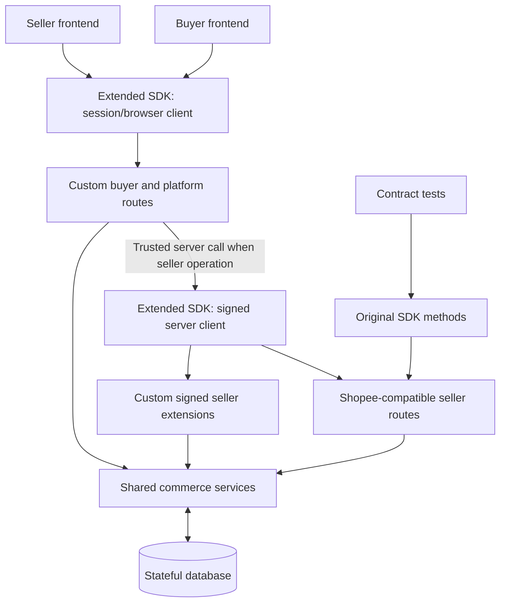

# Phase 1 API Endpoint Inventory

> Self-hosted simulated Shopee marketplace. **No voice/AI endpoints in Phase 1.**
> Maintained separately from `AGENTS.md` so scope and contract coverage can change independently.

## Legend and contract boundaries

- **P0**: required to demonstrate the first coherent buyer ↔ seller commerce workflows; **P1**: subsequent Phase 1 coverage.
- **Shopee-compatible**: preserve original Shopee Open API V2 endpoint paths, methods, request/response envelopes, auth and shop-scoping. Listed `module.operation` identifiers correspond to SDK/schema operation names; **consult each JSON schema for its exact HTTP method and URL** rather than inferring from a filename.
- **Custom session API**: project-defined HTTP routes under `/api/v1`, with public or cookie-session authentication and resource ownership checks.
- **Custom signed seller extension**: project-defined operation, **not** an official Shopee endpoint; requires shop-scoped access token + HMAC and is implemented in our extended SDK.
- **Extended SDK**: upstream-compatible seller methods must remain functional. Add typed methods for *both* new buyer/session routes and custom signed seller routes. Browser/client-facing extensions cannot embed `partner_key` or shop access tokens. The SDK is a client and a test driver, not the API server or a complete test suite.

## A. Shopee Open API V2-compatible seller endpoints

### A1. Authentication, shop and shop categories

| Priority | SDK/schema operation | Reason |
|---|---|---|
| P0 | `shop.auth_partner` | Signed shop authorization redirect (special browser-facing route) |
| P0 | `auth.token.get` | Exchange authorization code for tokens |
| P0 | `auth.access_token.get` | Refresh tokens |
| P0 | `public.get_shops_by_partner` | List the app's authorized shops |
| P0 | `shop.get_shop_info` | Seller shop details |
| P0 | `shop.get_profile` | Seller shop storefront profile |
| P0 | `shop.update_profile` | Edit shop profile (added) |
| P1 | `shop.get_shop_holiday_mode` | Shop availability status |
| P0 | `shop_category.get_shop_category_list` | Seller-managed storefront collections |
| P0 | `shop_category.get_item_list` | Items in a collection |
| P1 | `shop_category.add_shop_category` | Create collection (added) |
| P1 | `shop_category.update_shop_category` | Edit collection (added) |
| P1 | `shop_category.add_item_list` | Assign products to collection (added) |

### A2. Products, variants, media

| Priority | SDK/schema operation | Reason |
|---|---|---|
| P0 | `product.get_item_list` | Shop catalog |
| P0 | `product.search_item` | Search within authorized shop |
| P0 | `product.get_item_base_info` | Product details, pricing, stock and metadata |
| P0 | `product.get_model_list` | Variant-level pricing and inventory |
| P0 | `product.get_item_extra_info` | Sales/views/ratings metadata |
| P0 | `product.get_comment` | Existing reviews |
| P0 | `product.get_item_promotion` | Product-level promotions |
| P0 | `product.get_category` | Marketplace taxonomy |
| P0 | `product.get_attribute_tree` | Category attributes |
| P0 | `product.add_item` | Create product (added) |
| P0 | `product.update_item` | Edit product (added) |
| P0 | `product.init_tier_variation` | Initialize variation structure (added) |
| P0 | `product.add_model` | Add SKU/model (added) |
| P0 | `product.update_stock` | Update seller inventory |
| P0 | `product.update_price` | Update seller price |
| P0 | `media_space.upload_image` | Product image upload (added; SDK `media.uploadImage`) |
| P1 | `product.update_model` | Update SKU details (added) |
| P1 | `product.unlist_item` | Listing visibility (added) |
| P1 | `product.delete_item` | Delete product (added) |
| P1 | `product.get_brand_list` | Brand metadata (added) |

### A3. Promotions and vouchers

| Priority | SDK/schema operation | Reason |
|---|---|---|
| P0 | `voucher.get_voucher_list` | Shop vouchers (added) |
| P0 | `voucher.get_voucher` | Voucher rules (added) |
| P0 | `voucher.add_voucher` | Seller creates voucher (added) |
| P1 | `voucher.update_voucher` | Edit voucher (added) |
| P1 | `voucher.end_voucher` | End voucher (added) |

### A4. Orders and logistics

| Priority | SDK/schema operation | Reason |
|---|---|---|
| P0 | `order.get_order_list` | Seller orders |
| P0 | `order.get_order_detail` | Order detail |
| P0 | `order.cancel_order` | Seller-supported cancellation (validate conditions) |
| P0 | `logistics.get_channel_list` | Shipping options |
| P0 | `logistics.get_shipping_parameter` | Shipping prerequisites (added) |
| P0 | `logistics.get_address_list` | Seller pickup address selection (added) |
| P0 | `logistics.ship_order` | Arrange fulfillment (added) |
| P0 | `logistics.get_tracking_info` | Shipment tracking |
| P0 | `logistics.get_tracking_number` | Shipment reference |

### A5. Returns and refunds

| Priority | SDK/schema operation | Reason |
|---|---|---|
| P0 | `returns.get_return_list` | Shop return cases |
| P0 | `returns.get_return_detail` | Return details |
| P0 | `returns.get_available_solutions` | Eligible seller responses |
| P0 | `returns.confirm` | Seller return decision |
| P1 | `returns.get_reverse_tracking_info` | Reverse shipment tracking |
| P1 | `returns.offer` | Seller alternate offer |
| P1 | `returns.dispute` | Seller dispute |

### A6. Push configuration and simulated event delivery

| Priority | Endpoint/event | Reason |
|---|---|---|
| P1 | `push.set_app_push_config` | Register push target |
| P1 | `push.get_app_push_config` | Inspect push configuration |
| P1 | Outbound order/tracking/inventory/promotion event delivery | **Behavior**, not an additional SDK endpoint; implement documented payloads where available |

## B. Custom buyer/customer endpoints (add to extended SDK)

These are **project-owned**, not actual Shopee Open API V2 buyer methods. Base path: `/api/v1`.

### B1. Public marketplace

| Priority | Method | Route | Purpose |
|---|---|---|---|
| P0 | GET | `/marketplace/shops` | Explore shops |
| P0 | GET | `/marketplace/shops/:shopId` | Public shop profile |
| P0 | GET | `/marketplace/products` | Cross-shop search, filter, sort, paginate |
| P0 | GET | `/marketplace/products/:itemId` | Public product details and variants |
| P0 | GET | `/marketplace/products/:itemId/reviews` | Public reviews |
| P0 | GET | `/marketplace/categories` | Marketplace categories |
| P0 | GET | `/marketplace/shops/:shopId/vouchers` | Publicly eligible voucher metadata |
| P0 | GET | `/marketplace/shops/:shopId/policies` | Shipping, returns, warranty policy text |

### B2. Cart, checkout, delivery

| Priority | Method | Route | Purpose |
|---|---|---|---|
| P0 | GET | `/cart` | Current buyer cart |
| P0 | POST | `/cart/items` | Add product model and quantity |
| P0 | PATCH | `/cart/items/:cartItemId` | Change model/quantity |
| P0 | DELETE | `/cart/items/:cartItemId` | Remove cart item |
| P0 | POST | `/checkout/preview` | Recalculate stock, pricing, voucher eligibility and shipping |
| P0 | POST | `/checkout` | Simulated payment and order creation |
| P0 | GET | `/buyer/addresses` | Buyer delivery addresses |
| P0 | POST | `/buyer/addresses` | Create delivery address |
| P1 | PATCH | `/buyer/addresses/:addressId` | Edit delivery address |
| P1 | DELETE | `/buyer/addresses/:addressId` | Delete delivery address |
| P0 | POST | `/shipping/quote` | Simulated shipping fees/options |

### B3. Buyer orders, returns and reviews

| Priority | Method | Route | Purpose |
|---|---|---|---|
| P0 | GET | `/buyer/orders` | Purchases across shops |
| P0 | GET | `/buyer/orders/:orderId` | Own purchase detail |
| P0 | POST | `/buyer/orders/:orderId/cancel` | Buyer cancellation, when eligible |
| P0 | GET | `/buyer/orders/:orderId/tracking` | Own tracking events |
| P0 | POST | `/buyer/returns` | Create return request |
| P0 | GET | `/buyer/returns` | Own return requests |
| P0 | GET | `/buyer/returns/:returnId` | Return details |
| P1 | POST | `/buyer/returns/:returnId/accept-offer` | Accept seller offer |
| P1 | POST | `/buyer/orders/:orderId/reviews` | Add verified-purchase review |

## C. Custom platform identity and seller onboarding endpoints (add to extended SDK)

Base path: `/api/v1`. Web-facing requests use **server-managed sessions**, not Partner signing. These endpoints are not provided by the Shopee Open API V2 SDK upstream.

| Priority | Method | Route | Purpose |
|---|---|---|---|
| P0 | POST | `/auth/signup` | Buyer/seller account creation |
| P0 | POST | `/auth/login` | Create web session |
| P0 | POST | `/auth/logout` | End session |
| P0 | GET | `/auth/me` | Current identity and roles |
| P0 | POST | `/seller/shops` | Create a shop owned by seller |
| P0 | GET | `/seller/shops` | Seller's shops |
| P0 | GET | `/seller/shops/:shopId` | Current seller's shop |
| P0 | GET | `/seller/shops/:shopId/authorization-url` | Initiate shared-Partner OAuth-like consent |
| P0 | GET | `/integrations/shopee/callback` | Finish auth-code exchange server-side |
| P0 | GET | `/seller/shops/:shopId/connection-status` | Shop grant/token status |
| P1 | POST | `/seller/shops/:shopId/disconnect` | Revoke grant / disconnect shop |
| P1 | GET | `/seller/dashboard/summary` | Presentation-specific seller metrics |

## D. Project-owned signed seller extensions (add to extended SDK)

These operations are **not official Shopee APIs**, but intentionally reuse our shop-scoped `access_token` + HMAC verification. Paths below are proposals; implement only if required by Phase 1 seller UX. For platform policy editing, this avoids duplicating general product/order endpoints while supporting simulated shop policy configuration.

| Priority | Proposed method | Proposed route | Purpose |
|---|---|---|---|
| P0 | GET | `/api/v2/custom/shop/get_policies` | Read per-shop shipping/returns/warranty policies |
| P0 | POST | `/api/v2/custom/shop/update_policies` | Seller edits policy content and version |
| P1 | GET | `/api/v2/custom/shop/get_sales_summary` | Shop aggregate metrics, if dashboard requires them |

## E. Integration and acceptance flows

Must pass: seller signup → shop creation → shared-Partner authorization → shop-scoped token → SDK product listing/update → buyer sees state; buyer checkout → seller sees order → seller ships → buyer tracks; buyer return → seller handles; cross-shop and cross-buyer access denied; SDK original methods continue working unchanged.

## Implementation notes

- Use one **shared platform-managed Partner identity** in Phase 1. Store the `partner_key` only in backend/CI secrets; shop tokens remain independently authorized. The data model must allow future multiple Partner apps but app registration routes are **out of scope**.
- Do not replace original SDK endpoints with custom buyer semantics. Build custom endpoints and methods separately.
- Preserve upstream SDK public method contracts. Extend/fork the SDK for the new routes, potentially with a browser-safe client subset and distinct auth transports.
- `shopee-sdk` does not automatically provide tests for your server; create and maintain upstream compatibility tests **and** extension-specific tests.
- No AI/voice functionality, agent-tool endpoints, handoff or conversation analytics in this phase.

## Sources for contract verification

- SDK schema directory: https://github.com/congminh1254/shopee-sdk/tree/main/schemas
- SDK manager docs: https://github.com/congminh1254/shopee-sdk/tree/main/docs/managers
- Official API portal: https://open.shopee.com/documents

`P0`/`P1` assignments, custom paths, and custom behavior are project design decisions. Cross-check each SDK-compatible endpoint's exact method, request body, response shape and availability against the relevant schema during implementation.
