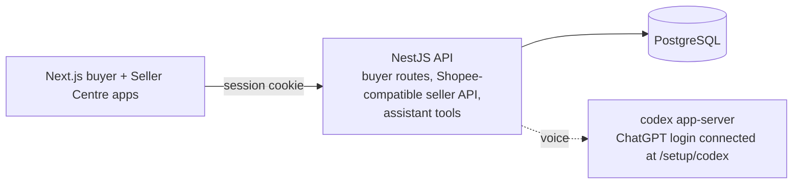

# Huspee

A simulated Shopee-like marketplace: a buyer storefront, a seller dashboard and a per-shop voice
shopping assistant, all running locally on mock data. No Shopee account or paid API is needed.
Huspee is unaffiliated with Shopee.

## Architecture



- `apps/web`: Next.js buyer storefront (port 3001).
- `apps/seller-web`: Huspee Kênh Người Bán (port 3002), seller routes without `/seller`.
- `packages/web-ui`: shared browser UI, translations, session/API client and assistant cards.
- `apps/api`: NestJS + Prisma backend. It serves custom buyer routes, a Shopee Open API v2-compatible
  seller API (signed, per-shop tokens) and the assistant's tools. `prisma/` has the schema and seed.
- `packages/sdk`: `@huspee/sdk`, a browser client and a server-only Shopee-compatible client.
- `tests`: upstream SDK, extension and end-to-end suites.

More detail: [`docs/PLATFORM.md`](docs/PLATFORM.md).

## Run it with Docker (recommended)

1. Install Docker and start it.
2. Run:
   ```bash
   git clone https://github.com/RyanNg1403/huspee.git
   cd huspee
   docker compose up --build
   ```
3. Open http://localhost:3001 for buyers and http://localhost:3002 for Seller Centre. The shop works right away with mock data; every password is
   `Password123!`.

Sign in as buyer `an.nguyen@example.com` and seller `huy.techzone@example.com`
(TechZone 880001) or `lan.glowup@example.com` (GlowUp 880002), all with `Password123!`.
Both apps can stay signed in within one browser profile. The buyer uses `huspee_sid`;
Seller Centre uses `huspee_seller_sid`. The backend binds each session to its surface and selects the cookie using
`X-Huspee-Surface: seller` (buyer is the default); logging out of one app leaves the other signed in.

To turn on voice (once per machine, needs ChatGPT Plus or Pro):

4. At https://chatgpt.com/settings/security, turn on
   **Enable device code sign-in for Codex, Excel, PowerPoint, and Word**.
5. Open http://localhost:3001/setup/codex. No Huspee account or seller sign-in is needed.
6. Click **Connect ChatGPT account**, open the link and enter the code.
7. Sign in as a buyer (`an.nguyen@example.com`), open any shop and click **Ask the assistant**.

Steps 4 to 6 happen once: the sign-in is shared by all shops and survives restarts and rebuilds.
`docker compose down -v` deletes the saved sign-in. The first build takes a few minutes. Every start reloads fresh mock data. Compose uses
ports 3000 (API), 3001 (buyer), 3002 (seller) and 5432; stop anything else on them first (a local Postgres often
holds 5432).

`/setup/codex` is the only Codex sign-in page. **Seller Centre > Assistant** contains per-shop
settings, FAQs, logs and insights, with no account sign-in controls. The setup page only exposes a
pending sign-in code to the browser that started it; other browsers see a waiting status. Account
disconnection remains a seller-authenticated maintenance API operation, not a public setup action.

## Open on a phone

For **one public URL**, keep the tunnel on buyer port 3001 and serve Seller Centre at
`https://your-public-host/seller`:

- Build `apps/seller-web` with `SELLER_BASE_PATH=/seller` in its environment.
- Set buyer `SELLER_INTERNAL_URL=http://127.0.0.1:3002` (or the actual seller port).
- Set buyer and API `SELLER_APP_URL=https://your-public-host/seller`.
- Set both frontends and API `WEB_APP_URL=https://your-public-host`.
- Keep `API_INTERNAL_URL` pointed at the API, `API_PUBLIC_URL` matching its
  `PUBLIC_BASE_URL`, and API `BROWSER_PROXY_ENABLED=true`.

The buyer app reverse-proxies `/seller` and its assets to Seller Centre; API/media stay
at the origin root. The two session cookies remain independent. No second tunnel or
Nginx is required. Changing `SELLER_BASE_PATH` requires rebuilding Seller Centre.
Leave `SELLER_INTERNAL_URL` and `SELLER_BASE_PATH` unset to use separate public origins:

Forward **port 3001** and open its **HTTPS** URL on the phone. The buyer server proxies
API, media, session cookies and assistant events through that origin. Set its
`API_INTERNAL_URL` to the API's listening address. Seller Centre is a separate desktop
site: forward port 3002 separately when needed and set buyer `SELLER_APP_URL` to that URL.
Seller `API_PUBLIC_URL` must match the API's `PUBLIC_BASE_URL`; its proxy handles both
absolute and relative consent URLs. Seller `WEB_APP_URL` points back to the buyer site. Configure API `WEB_APP_URL` and
`SELLER_APP_URL` with the respective public origins for CORS and callbacks.
`BROWSER_PROXY_ENABLED=true` keeps authorization/media URLs relative; both frontend proxies
also localize known redirect origins, so consent remains on the seller tunnel.

Plain HTTP on a LAN IP supports browsing but cannot request a phone microphone. HTTPS forwarding
and microphone permission are required for voice, along with the ChatGPT connection described above.
The assistant fills phone screens and follows the visible viewport when the keyboard opens. The page behind it is locked; only messages scroll, while the header and composer stay visible. The back arrow hides the chat and restores the page position. During a call, the microphone meter shows actual local input, with separate quiet, muted, push-to-talk and interrupted states.

For a temporary public link, run `cloudflared tunnel --url http://localhost:3001` and open the
printed HTTPS URL. On `*.trycloudflare.com`, the assistant automatically polls for JSON events
because Quick Tunnels do not support SSE. The link lasts while the tunnel process is running.

## Mock data

Every account's password is `Password123!`.

| Role | Email | Shop |
|---|---|---|
| Buyer | `an.nguyen@example.com`, `binh.tran@example.com`, `cuong.le@example.com` | |
| Seller | `huy.techzone@example.com` | TechZone Official (electronics) |
| Seller | `lan.glowup@example.com` | GlowUp Beauty (beauty) |
| Seller | `tuan.saigonstyle@example.com` | Saigon Style (fashion) |
| Seller | `trang.nhaxinh@example.com` | Nhà Xinh Home (home and living) |

There are 4 shops and 80 products (20 per shop) with variants, photos, reviews, vouchers, shipping options,
policies, past orders and assistant FAQs. Prices are in VND.

Each product has at least two Image Gen images, every offered color has a matching image, and each shop has a generated avatar. Electronics,
skincare and makeup, clothing and bags, and kitchenware and home accessories have distinct
catalogs. The 170 images total about 4.3 MiB in compact WebP files: product images are at most 1024×1024 and
200 KB; avatars are at most 512×512 and 75 KB. Large original renders are excluded from Git.
Prompts and provenance: [`apps/api/prisma/generated-images/README.md`](apps/api/prisma/generated-images/README.md).

To add the expanded fixtures and refresh their images in an existing database while preserving
orders, carts, login state and seller edits, run `pnpm db:catalog:sync`. It preserves custom uploaded
images. With Docker, run `docker compose exec api pnpm db:catalog:sync` after rebuilding the image;
use `HUSPEE_SEED_ON_START=false docker compose up -d --build` to preserve existing data on restart.
`pnpm db:seed` and the default Compose startup reset the demo database.

A seller must link their shop once before managing it: sign in, open http://localhost:3002/shops, click Connect
and approve.

## Run it locally (for development)

You need Node 22+, pnpm 10 and PostgreSQL 16. Create the database the defaults expect:

```bash
createuser -s huspee && psql -c "alter user huspee password 'huspee'" postgres && createdb -O huspee huspee
```

Then:

```bash
pnpm install
cp apps/api/.env.example apps/api/.env
cp apps/web/.env.example apps/web/.env.local
pnpm --filter @huspee/sdk build   # the web app uses the built SDK
pnpm db:migrate
pnpm db:seed                      # load mock data; run again any time to reset it
pnpm dev                          # API -> http://localhost:3000
pnpm dev:web                      # buyer -> http://localhost:3001 (second terminal)
pnpm dev:seller-web               # seller -> http://localhost:3002 (third terminal)
pnpm build:web                   # builds both Next.js apps
```

Both frontend apps use `API_INTERNAL_URL` (server-to-API), `API_PUBLIC_URL` (the API's
public origin for consent URLs) and `WEB_APP_URL` (buyer origin). Buyer also reads
`SELLER_APP_URL` at runtime, defaulting to `http://localhost:3002`. Copy the buyer's
`.env.example` to `apps/seller-web/.env.local` when using non-default ports. Browser
requests always go through their app origin; `NEXT_PUBLIC_API_URL` is no longer used.
API `SELLER_APP_URL` also defaults to `http://localhost:3002` and controls the consent callback
destination and second allowed CORS origin. Run `pnpm db:migrate` to apply the additive
`20261031090000_session_surface` migration; existing sessions keep the buyer/default surface.
Seller Centre cookies issued by the previous cookie-renaming proxy require a new seller sign-in;
existing default buyer sessions remain valid.
Old buyer `/seller/*` links redirect to Seller Centre. `/setup/codex` stays on buyer;
Seller Centre links to it through the runtime buyer origin. No API routes were added.

Run `WEB_URL=http://localhost:3001 SELLER_URL=http://localhost:3002 pnpm smoke:dual-session`
for the single-context browser regression (voice stays disabled for automated checks).

## Voice assistant

Each shop page has an assistant that answers from that shop's data and can add to cart, place
orders and open returns after the buyer confirms. It runs on a ChatGPT account through Codex
(`codex-cli 0.166.0`), not an OpenAI API key, and each session uses that account's subscription.

**Requires a paid ChatGPT plan:** Plus or above (Plus, Pro). Codex voice (`/voice`) is not
available on the Free plan, so the assistant cannot start a voice session with a Free account.

It is connected once from `/setup/codex` (steps 4 to 6 above) and then works on every shop. Until
then, the assistant panel tells buyers it is not connected yet and the rest of the app works.

- **Docker:** the API image includes `codex-cli 0.166.0`; you do not need Codex on your machine.
- **Local:** install `codex-cli 0.166.0` (`npm install -g @openai/codex@0.166.0`) and start the API.
  Connect from http://localhost:3001/setup/codex, the same as Docker. Existing host-linked logins
  are still recognized for local development.

To turn the assistant off, set `ASSISTANT_VOICE_ENABLED=false` (in `apps/api/.env`, or in the shell
for Docker). Details: [`docs/VOICE.md`](docs/VOICE.md).

## Tests

```bash
pnpm test   # builds, then runs all suites against a reseeded huspee_test database
WEB_URL=http://localhost:3001 SELLER_URL=http://localhost:3002 API_URL=http://localhost:3000 pnpm smoke:ui   # browser smoke test; needs running servers and Chrome
```

`pnpm test` needs a Postgres role that can create `huspee_test` (override with `TEST_DATABASE_URL`).
No test starts a real Codex session.

## More docs

- [`AGENTS.md`](AGENTS.md): requirements and rules for contributors and coding agents
- [`BRIEF.md`](BRIEF.md): product brief
- [`PHASE1_ENDPOINTS.md`](PHASE1_ENDPOINTS.md): every API route, its auth and tests
- [`docs/COMPATIBILITY.md`](docs/COMPATIBILITY.md): how closely the seller API matches Shopee
- [`docs/ASSISTANT.md`](docs/ASSISTANT.md), [`docs/VOICE.md`](docs/VOICE.md), [`docs/EVAL.md`](docs/EVAL.md): assistant contract, voice runtime, evaluation
- [`packages/sdk/README.md`](packages/sdk/README.md): SDK usage and changes from upstream
