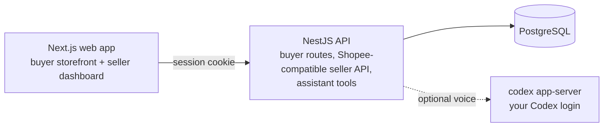

# Huspee

A simulated Shopee-like marketplace: a buyer storefront, a seller dashboard and a per-shop voice
shopping assistant, all running locally on mock data. No Shopee account or paid API is needed.
Huspee is unaffiliated with Shopee.

## Architecture



- `apps/web`: Next.js buyer storefront and seller dashboard.
- `apps/api`: NestJS + Prisma backend. It serves custom buyer routes, a Shopee Open API v2-compatible
  seller API (signed, per-shop tokens) and the assistant's tools. `prisma/` has the schema and seed.
- `packages/sdk`: `@huspee/sdk`, a browser client and a server-only Shopee-compatible client.
- `tests`: upstream SDK, extension and end-to-end suites.

More detail: [`docs/PLATFORM.md`](docs/PLATFORM.md).

## Run it with Docker (recommended)

You need Docker. Then:

```bash
git clone https://github.com/RyanNg1403/huspee.git
cd huspee
docker compose up --build
```

Open http://localhost:3001 (the API is on http://localhost:3000). The first build takes a few minutes.
Every start migrates the database and reloads fresh mock data, so changes do not survive a restart.

Compose uses ports 3000, 3001 and 5432; stop anything else on them first (a local Postgres often
holds 5432).

## Mock data

Every account's password is `Password123!`.

| Role | Email | Shop |
|---|---|---|
| Buyer | `an.nguyen@example.com`, `binh.tran@example.com`, `cuong.le@example.com` | |
| Seller | `huy.techzone@example.com` | TechZone Official (electronics) |
| Seller | `lan.glowup@example.com` | GlowUp Beauty (beauty) |
| Seller | `tuan.saigonstyle@example.com` | Saigon Style (fashion) |
| Seller | `trang.nhaxinh@example.com` | Nhà Xinh Home (home and living) |

There are 4 shops and 15 products with variants, photos, reviews, vouchers, shipping options,
policies, past orders and assistant FAQs. Prices are in VND.

A seller must link their shop once before managing it: sign in, open `/seller/shops`, click Connect
and approve.

## Run it locally (for development, and for voice)

You need Node 22+, pnpm 10 and PostgreSQL 16. Create the database the defaults expect:

```bash
createuser -s huspee && psql -c "alter user huspee password 'huspee'" postgres && createdb -O huspee huspee
```

Then:

```bash
pnpm install
cp apps/api/.env.example apps/api/.env
cp apps/web/.env.example apps/web/.env.local
pnpm --filter @huspee/sdk build   # the web app uses the built SDK
pnpm db:migrate
pnpm db:seed                      # load mock data; run again any time to reset it
pnpm dev                          # API -> http://localhost:3000
pnpm dev:web                      # web -> http://localhost:3001 (second terminal)
```

## Voice assistant (optional, local setup only)

Each shop page has an assistant that answers from that shop's data and can add to cart, place
orders and open returns after the buyer confirms. It runs on your own Codex login
(`codex-cli 0.166.0`), not an OpenAI API key, and each session uses your subscription.

**Requires a paid ChatGPT plan:** Plus or above (Plus, Pro). Codex voice (`/voice`) is not
available on the Free plan, so the assistant cannot start a voice session with a Free account.

It is on by default: install `codex-cli 0.166.0`, run `codex login`, and start the API. To turn it
off, set `ASSISTANT_VOICE_ENABLED=false` in `apps/api/.env`. The Docker images do not include Codex,
so there the assistant shows as unavailable and the rest of the app works normally. Details: [`docs/VOICE.md`](docs/VOICE.md).

## Tests

```bash
pnpm test   # builds, then runs all suites against a reseeded huspee_test database
WEB_URL=http://localhost:3001 API_URL=http://localhost:3000 pnpm smoke:ui   # browser smoke test; needs running servers and Chrome
```

`pnpm test` needs a Postgres role that can create `huspee_test` (override with `TEST_DATABASE_URL`).
No test starts a real Codex session.

## More docs

- [`AGENTS.md`](AGENTS.md): requirements and rules for contributors and coding agents
- [`BRIEF.md`](BRIEF.md): product brief
- [`PHASE1_ENDPOINTS.md`](PHASE1_ENDPOINTS.md): every API route, its auth and tests
- [`docs/COMPATIBILITY.md`](docs/COMPATIBILITY.md): how closely the seller API matches Shopee
- [`docs/ASSISTANT.md`](docs/ASSISTANT.md), [`docs/VOICE.md`](docs/VOICE.md), [`docs/EVAL.md`](docs/EVAL.md): assistant contract, voice runtime, evaluation
- [`packages/sdk/README.md`](packages/sdk/README.md): SDK usage and changes from upstream
